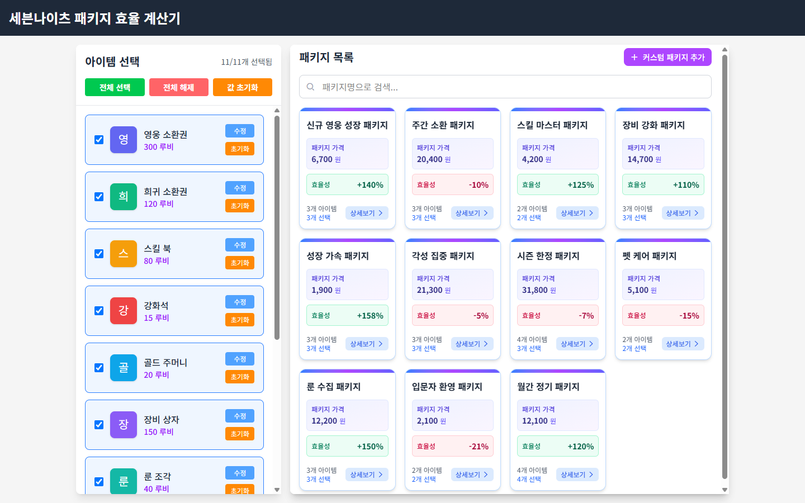
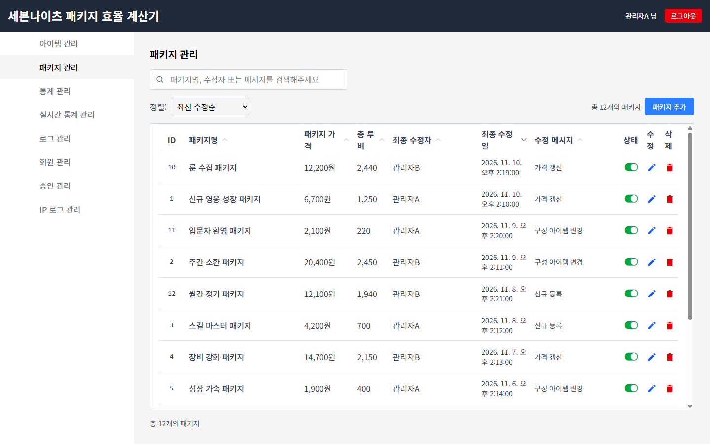
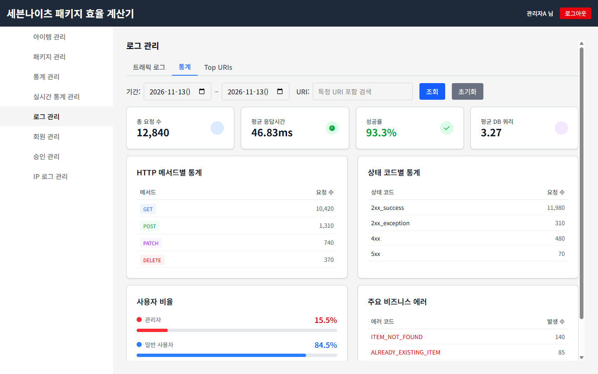
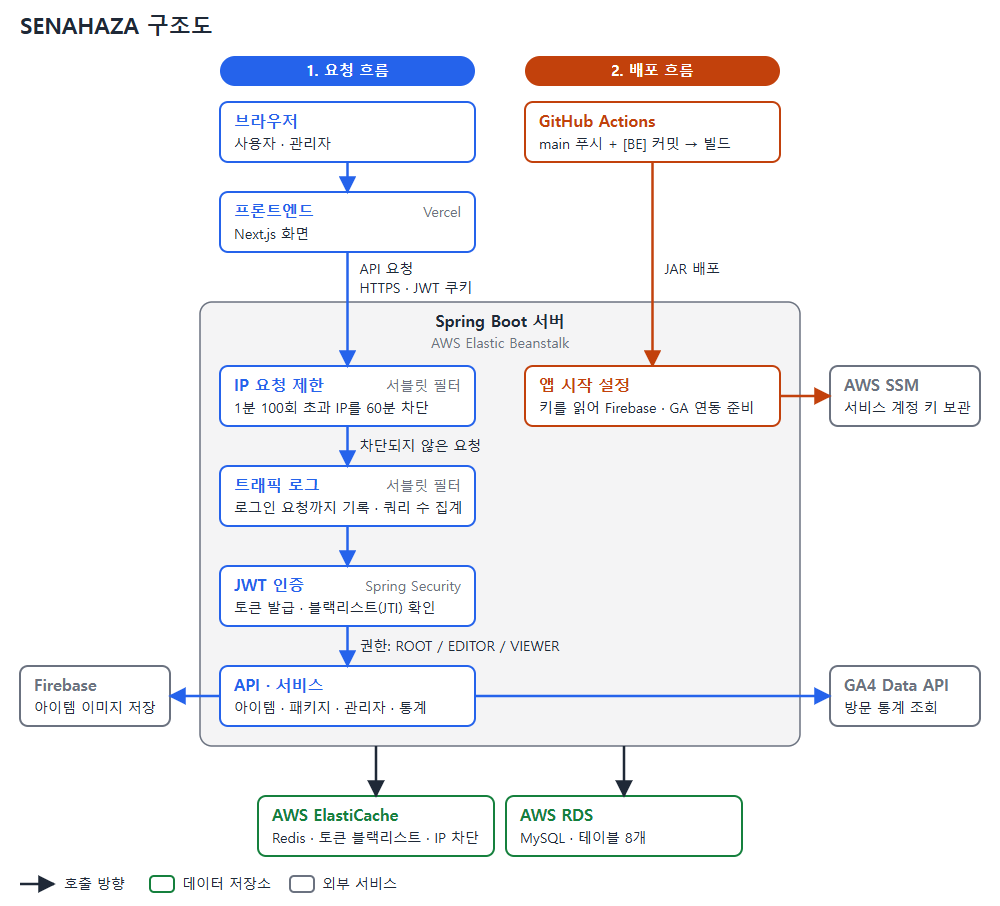
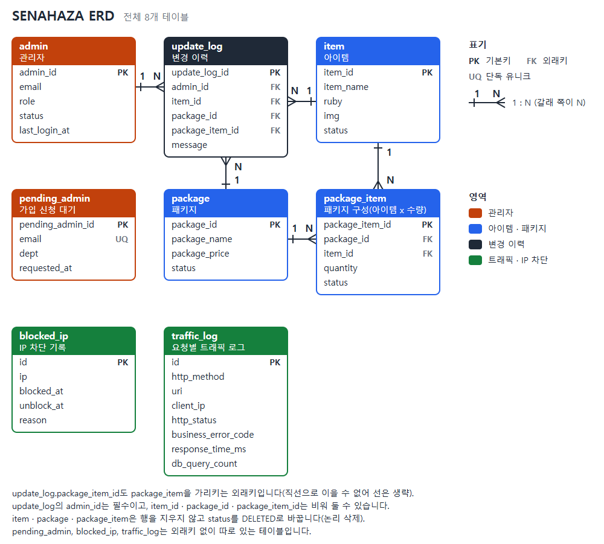

# SENAHAZA (세나하자)

세븐나이츠: 리버스(모바일 게임)의 패키지 상품을 아이템 구성으로 비교(총 루비·현금 환산)하는 화면과, 관리자가 코드 수정·재배포 없이 아이템·패키지를 관리하고 트래픽·방문 통계를 보는 관리자 페이지.

- 상태: 서비스 종료 (2025.07 배포, 무료 사용 기간(1년)이 끝나 서버를 내림)
- 기간: 2025.06 ~ 2025.07
- 인원: 2명 (백엔드 1, 프론트엔드 1)
- 개발일지: [senahaza 시리즈](https://velog.io/@swmoon7/series/senahaza) (백엔드 기준)

## 화면

서비스를 내리기 전에 화면을 남기지 못해, 프론트엔드 코드를 로컬에서 실행하고 서버 응답을 예시 데이터로 대신해 캡처했다. 아이템·패키지 이름, 가격, 통계 숫자는 예시 값이다.

| 사용자 화면 (아이템 선택 → 패키지 효율) | 관리자: 패키지 관리 |
|---|---|
|  |  |

관리자: 트래픽 로그 통계



## 주요 기능

일반 사용자는 로그인 없이 쓰고, 관리자는 로그인 후 권한에 따라 쓴다.

1. 관리자 3단계 권한과 가입 승인: 가입 신청 → ROOT 승인 → VIEWER로 시작. 권한은 ROOT / EDITOR / VIEWER이고, 권한 변경·삭제는 ROOT만 한다.
2. 아이템·패키지 관리: 등록·수정·상태 변경·삭제, 이미지 업로드, 모든 변경을 변경 이력으로 기록. 패키지의 총 루비·현금 환산은 조회할 때 계산한다.
3. 트래픽 로그와 통계: 요청 제한에 걸리지 않은 요청의 응답 시간, 요청당 DB 쿼리 수, 비즈니스 에러 코드를 기록하고, 로그 조회·통계·Top 요청 URI를 보여 준다.
4. 방문 통계: 백엔드가 Google Analytics(GA4) Data API를 호출한다. 보고서 6종과 실시간 5종.
5. IP 요청 제한: 1분에 100회를 넘는 IP를 60분 차단하고, 관리자가 차단 기록을 조회·해제한다.

프론트엔드는 팀원이 맡았다. 아이템 체크로 패키지 효율을 보는 사용자 화면과 관리자 화면이 여기에 해당한다.

## 기술 스택

| 구분 | 사용 기술 |
|---|---|
| 백엔드 | Java 11, Spring Boot 2.7.14, Spring Security, Spring Data JPA, QueryDSL 5.0.0, JJWT 0.12.3, Spring Data Redis, Firebase Admin 9.2.0, Google Analytics Data(libraries-bom 26.62.0), datasource-proxy 1.7, AWS SDK v1 SSM 1.12.603, MySQL, Gradle 8.13 |
| 프론트엔드 | Next.js 16, React 19, TypeScript 5, Zustand 5, Tailwind CSS 4, axios, chart.js 4 (저장소 `package.json` 기준) |
| 인프라 | AWS Elastic Beanstalk, RDS MySQL, ElastiCache Redis, AWS SSM Parameter Store, GitHub Actions CI/CD. 프론트는 Vercel, HTTPS는 Let's Encrypt(Certbot) + Nginx |
| 로컬 개발 | Docker (MySQL, Redis) |

## 구조도



- 요청 흐름: 브라우저 → 프론트엔드(Vercel) → Spring Boot 서버(Elastic Beanstalk). 서버 안에서 IP 요청 제한 → 트래픽 로그 → JWT 인증 순서의 필터를 거쳐 API·서비스에 닿는다.
- 데이터: MySQL(RDS)에 테이블 8개, Redis(ElastiCache)에 토큰 블랙리스트와 IP 차단 정보. 아이템 이미지는 Firebase Storage, 방문 통계는 GA4 Data API를 쓴다.
- 배포 흐름(운영 당시): `main`에 푸시하고 커밋 메시지에 `[BE]`가 있으면 GitHub Actions가 빌드해 배포했다. 서비스를 내린 뒤에는 자동 실행을 막고 수동 실행만 남겼다. Firebase·GA 연동 키는 AWS SSM에 두고 앱이 시작할 때 읽었다.

## ERD



테이블 8개. 관리자(admin, pending_admin), 아이템·패키지(item, package, package_item), 변경 이력(update_log)은 연결돼 있고, blocked_ip와 traffic_log는 외래키 없이 따로 있는 테이블이다. item·package·package_item은 행을 지우지 않고 status를 DELETED로 바꾸는 논리 삭제를 쓴다.

## 내가 맡은 부분

백엔드와 배포는 내가, 프론트엔드는 팀원 1명이 맡았다.

- 백엔드: 관리자 인증·권한·가입 승인, 아이템·패키지 관리와 이미지 업로드, 트래픽 로그·통계, IP 요청 제한, GA4 연동, 예외 처리
- 배포: AWS(Elastic Beanstalk, RDS, ElastiCache) 구성, GitHub Actions CI/CD, 도메인과 HTTPS
- 저장소 기준(2026-11): 백엔드 경로 커밋 91개는 전부 내가 작성했고, PR 2개도 내가 올렸다. 프론트엔드 경로 커밋 37개는 전부 팀원이다.
- 예외 처리: 비즈니스 예외는 HTTP 200으로 응답하고 본문의 에러 코드로 구분했다(검증 실패는 400, 인증 실패는 401).
- 설계: 구현 전에 Jira로 기능 명세를, ERDCloud로 ERD를 먼저 정리했다.

### 문제 해결

**1. 트래픽 로그에 로그인 요청이 남지 않음**
- 문제: 트래픽 로그를 `HandlerInterceptor`로 만들었더니, 로그인처럼 Spring Security 필터 단계에서 처리되는 요청의 로그가 남지 않았다.
- 해결: Interceptor는 `DispatcherServlet` 이후에 실행되고 Security 인증은 그보다 앞 필터 단계라는 순서 차이를 확인했다. `OncePerRequestFilter` 기반 `TrafficLoggingFilter`로 바꾸고 인증 필터 앞에 등록했다. 요청당 DB 쿼리 수는 `ProxyDataSource`와 `ThreadLocal`로 세고, 응답이 200이어서 상태 코드로 구분되지 않는 비즈니스 에러 코드는 예외 처리기가 요청에 담아 필터가 꺼내 기록한다.
- 결과: 로그인 요청을 포함한 요청이 기록된다.

**2. 권한을 바꿔도 기존 JWT가 계속 유효함**
- 문제: JWT는 서버가 상태를 갖지 않아, ROOT가 권한을 바꾸거나 계정을 삭제해도 이미 발급된 토큰이 만료 전까지 통했다.
- 해결: JWT에 `jti`를 넣고 로그인할 때 Redis에 저장했다. 요청마다 블랙리스트 여부를 확인하고, 권한 변경·삭제·로그아웃 때는 해당 계정의 활성 토큰을 모두 블랙리스트로 옮긴다. 블랙리스트 항목은 남은 만료 시간만큼 두어 TTL로 지워진다. DB 대신 TTL이 있고 빠른 Redis를 골랐다.
- 결과: 권한 변경·삭제·로그아웃 때 기존 토큰이 만료 전에 무효화된다(JWT 만료는 6시간). JWT가 들어간 Mock 테스트가 복잡해, 로컬 서버와 Postman으로 확인했다.

## 실행 방법

필요한 것: JDK 11, Docker(로컬 MySQL·Redis), Node.js

### 백엔드

```powershell
cd sena-back
.\gradlew bootRun
```

- 설정(`application.yml`)에서 DB·Redis 접속 정보, JWT 설정, GA 속성 ID(`analytics.google.property-id`)를 채운다.
- Firebase와 GA 서비스 계정 키는 파일이 아니라 AWS SSM Parameter Store에서 읽는다. 로컬에서 실행하려면 SSM 접근 설정이 필요하다.

### 프론트엔드

```powershell
cd sena-front
npm install
npm run dev
```

## 폴더 구조

```
senahaza
├─ sena-back
│  └─ src/main/java/org/example
│     ├─ admin        관리자 가입·승인·권한, 아이템·패키지 편집, 조회
│     ├─ analytics    GA4 보고서·실시간 조회
│     ├─ common       사용자 화면용 조회
│     ├─ config       Security, CORS, DataSource, Firebase, GA 설정
│     ├─ entity       아이템·패키지 엔티티
│     ├─ exception    커스텀 예외, 전역 예외 처리
│     ├─ filter       IP 요청 제한, 트래픽 로그, 요청·응답 로깅
│     ├─ jwt          로그인 필터, JWT 검증, 토큰 블랙리스트
│     ├─ redis        Redis 서비스, IP 요청 수 제한
│     └─ traffic      트래픽 로그 저장·통계
├─ sena-front
│  └─ src            Next.js 화면 (팀원 담당)
└─ .github/workflows  CI/CD(AWS 배포용, 지금은 수동 실행만 남김)
```

## 관련 글

velog [@swmoon7](https://velog.io/@swmoon7)

- [senahaza 개발일지 시리즈](https://velog.io/@swmoon7/series/senahaza)
- [[포트폴리오 제작 일지 #3] SENAHAZA 프로젝트 회고](https://velog.io/@swmoon7/포트폴리오-제작-일지-2-SENAHAZA-프로젝트-회고)
- [HttpOnly 쿠키로 JWT 인증했더니, 프론트·백 분리 배포에서 막혔다](https://velog.io/@swmoon7/HttpOnly-쿠키로-JWT-인증했더니-프론트백-분리-배포에서-막혔다)
- [AWS 프리티어를 활용한 앱 배포 가이드 (25.07.05기준)](https://velog.io/@swmoon7/AWS-프리티어를-활용한-앱-배포-가이드-25.07.05기준)
- [Route53 없이 HTTPS 적용하는 서브도메인 구성법](https://velog.io/@swmoon7/Route53-없이-HTTPS-적용하는-서브도메인-구성법)
